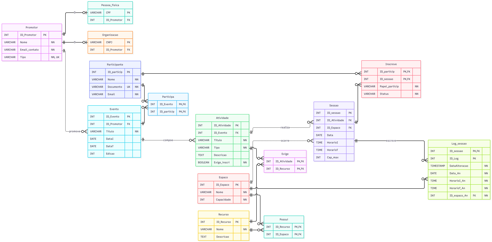

# Event Manager

Projeto desenvolvido para a disciplina **SCC0640 - Bases de Dados** (ICMC - USP), focado na modelagem conceitual, lógica e física de um banco de dados relacional robusto para gestão de eventos, alocações de espaços físicos e controle de inscrições, integrado a uma aplicação CLI em Python com suporte a consultas em linguagem natural (**Text-to-SQL**) utilizando Inteligência Artificial executada localmente.

A organização de eventos acadêmicos e corporativos frequentemente enfrenta desafios críticos de consistência de dados, como choque de horários em salas, alocação de locais sem os equipamentos necessários, superlotação e rigidez cadastral quando uma mesma pessoa atua como palestrante em uma atividade e ouvinte em outra. Para solucionar esses problemas diretamente na camada de dados, projetamos e implementamos uma arquitetura em **PostgreSQL** que aplica especialização total e disjunta de promotores (pessoas físicas e organizações), polimorfismo de papéis por sessão, controle de vagas com listas de espera e auditoria automática de mudanças na programação por meio de *triggers*. Como resultado, o sistema assegura total integridade transacional contra condições de corrida e sobreposições espaço-temporais, além de facilitar o acesso a relatórios complexos através de uma interface em **Python** integrada ao **Ollama** (`qwen3:8b`), capaz de converter perguntas em português em consultas SQL seguras em tempo real.

## Habilidades Utilizadas e Desenvolvidas

* **Modelagem de Dados Relacional:** Construção de Diagrama Entidade-Relacionamento (MER), mapeamento de entidades fracas, relacionamentos N:M com atributos próprios e hierarquias de generalização/especialização total e disjunta.
* **SQL Avançado (PostgreSQL):** Elaboração de consultas analíticas com *CTEs*, *Window Functions*, agregações condicionais, subconsultas, restrições de exclusão espaço-temporal e validações com *Regex*.
* **Programação Procedural e Concorrência (PL/pgSQL):** Desenvolvimento de *Triggers* e *Constraint Triggers* adiados para imposição de regras de negócio, geração automática de logs de auditoria e controle de concorrência com bloqueio pessimista.
* **Desenvolvimento Python & Integração com IA (Text-to-SQL):** Gerenciamento de conexões e transações com `psycopg` (v3) e integração com LLMs locais via **Ollama** (`qwen3:8b`), aplicando engenharia de prompt baseada no esquema DDL e higienização de código SQL gerado.

## Diagrama Entidade-Relacionamento (Modelo Relacional)



## Tecnologias e Pré-requisitos

* **Banco de Dados:** PostgreSQL (com extensão nativa `btree_gist`)
* **Linguagem de Programação:** Python 3.11 ou superior
* **Execução de LLM Local:** [Ollama](https://ollama.com/)
* **Modelo de Linguagem:** `qwen3:8b`
* **Bibliotecas Python:**
  * `psycopg[binary]` (Driver PostgreSQL para Python)
  * `ollama` (SDK oficial para comunicação com o servidor local do Ollama)

## Como Executar o Projeto

### 1. Preparação do Banco de Dados (DDL e DML)

1. Conecte-se à sua instância local do **PostgreSQL** e crie um novo banco de dados (por padrão, `eventos`):

   ```sql
   CREATE DATABASE eventos;
   ```

2. Abra o arquivo `Projeto.txt`, copie o código SQL presente na seção **`3. DDL COMPLETO`** e execute-o no banco de dados criado para estruturar os tipos `ENUM`, tabelas, restrições e triggers (opcionalmente, o próprio script Python pode executar o DDL caso o banco esteja vazio).

3. Abra o arquivo `DML.sql` e execute todos os comandos de inserção no banco de dados para populá-lo com a massa de dados de teste (8 eventos, 24 atividades, 25 sessões, 16 participantes, recursos, espaços e logs de auditoria).

### 2. Configuração do Ollama (IA Local)

1. Certifique-se de que o [Ollama](https://ollama.com/) está instalado e em execução na sua máquina (porta padrão `11434`).

2. Baixe o modelo utilizado pelo projeto executando no terminal:

   ```bash
   ollama pull qwen3:8b
   ```

### 3. Configuração e Execução do Protótipo em Python

1. Abra o arquivo `config.json` (localizado dentro da pasta `Prototipo`) e verifique se os parâmetros de conexão correspondem às credenciais do seu PostgreSQL local:

   ```json
   {
     "database": {
       "host": "localhost",
       "port": 5432,
       "dbname": "eventos",
       "user": "postgres",
       "password": "sua_senha_aqui"
     },
     "ollama": {
       "host": "http://localhost:11434",
       "model": "qwen3:8b"
     }
   }
   ```

2. Pelo terminal, navegue até a pasta `Prototipo` e instale as dependências necessárias:

   ```bash
   python -m pip install -r requirements.txt
   ```

3. Inicie a aplicação interativa executando:

   ```bash
   python main.py
   ```

4. No menu interativo do terminal, escolha entre:
   * **`1`**: Executar automaticamente as 5 consultas analíticas do projeto e visualizar as tabelas formatadas.
   * **`2`**: Fazer uma pergunta em português (linguagem natural) para que o modelo `qwen3:8b` gere e execute o `SELECT` correspondente em tempo real.
   * **`3`**: Encerrar a conexão e sair do sistema.